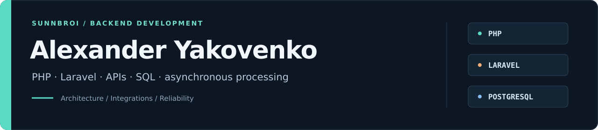

**English** · [Русский](README.ru.md)

I build PHP / Laravel backends for API-driven applications, external service integrations and background processing. My focus is clear domain boundaries, SQL performance and business logic that can be verified with tests.

## Selected projects

| Project | Engineering focus |
|---|---|
| **[Reservation Core](https://github.com/sunnbroi/reservation-core)** | Limited-capacity reservations and payment coordination. PostgreSQL row locks, idempotency, transactional outbox and tests with concurrent PHP processes. |
| **[Voice2AI](https://github.com/sunnbroi/voice2ai-multi-provider-telephony-integration)** | A Laravel application that normalizes calls from multiple telephony providers, processes recordings and runs queued analysis and notifications. |
| **[Address Book Microservice](https://github.com/sunnbroi/address-book-microservice)** | Recipient management and Telegram integration with signed requests, webhooks and Redis-backed background jobs. |

For a closer look at how I approach failure cases, start with the [concurrency tests](https://github.com/sunnbroi/reservation-core/blob/main/tests/Integration/ConcurrencyTest.php), [architecture decisions](https://github.com/sunnbroi/reservation-core/blob/main/docs/decisions.md) and [CI checks](https://github.com/sunnbroi/reservation-core/actions).

## Tools I work with

| Area | Technologies |
|---|---|
| Backend | PHP · Laravel · REST APIs |
| Data | PostgreSQL · MySQL · Redis |
| Integration and delivery | Queues · Webhooks · Docker · GitHub Actions |
| Quality | PHPUnit · PHPStan · Laravel Pint |
| Web interfaces | React · TypeScript |

## Contact

[LinkedIn](https://www.linkedin.com/in/sunnbroi/) · [Telegram](https://t.me/sunnbroi)
