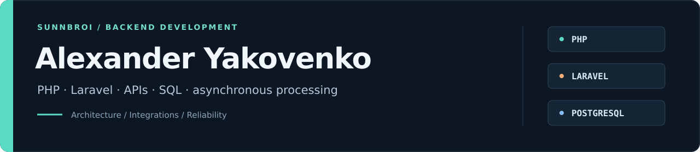

[English](README.md) · **Русский**

Разрабатываю серверную часть приложений на PHP и Laravel: REST API, интеграции с внешними сервисами и фоновую обработку. В работе уделяю внимание границам модулей, производительности SQL и проверке бизнес-логики тестами.

## Избранные проекты

| Проект | Что можно посмотреть в коде |
|---|---|
| **[Reservation Core](https://github.com/sunnbroi/reservation-core)** | Резервирование ограниченной вместимости и согласование оплаты. Блокировки PostgreSQL, идемпотентность, transactional outbox и тесты с параллельными PHP-процессами. |
| **[Voice2AI](https://github.com/sunnbroi/voice2ai-multi-provider-telephony-integration)** | Laravel-приложение для работы с несколькими провайдерами телефонии: нормализация звонков, обработка записей, анализ и уведомления через очереди. |
| **[Address Book Microservice](https://github.com/sunnbroi/address-book-microservice)** | Управление получателями и интеграция с Telegram: подписанные запросы, вебхуки и фоновые задачи с Redis. |

Разобраться в обработке сбоев и параллельных запросов помогут [конкурентные тесты](https://github.com/sunnbroi/reservation-core/blob/main/tests/Integration/ConcurrencyTest.php), [архитектурные решения](https://github.com/sunnbroi/reservation-core/blob/main/docs/decisions.md), [проверки CI](https://github.com/sunnbroi/reservation-core/actions) и [разбор логики на русском](https://github.com/sunnbroi/reservation-core/blob/main/docs/walkthrough.ru.md).

## Рабочие инструменты

| Область | Технологии |
|---|---|
| Backend | PHP · Laravel · REST API |
| Данные | PostgreSQL · MySQL · Redis |
| Интеграции и инфраструктура | Очереди · Вебхуки · Docker · GitHub Actions |
| Качество кода | PHPUnit · PHPStan · Laravel Pint |
| Веб-интерфейсы | React · TypeScript |

## Связаться со мной

[LinkedIn](https://www.linkedin.com/in/sunnbroi/) · [Telegram](https://t.me/sunnbroi)
